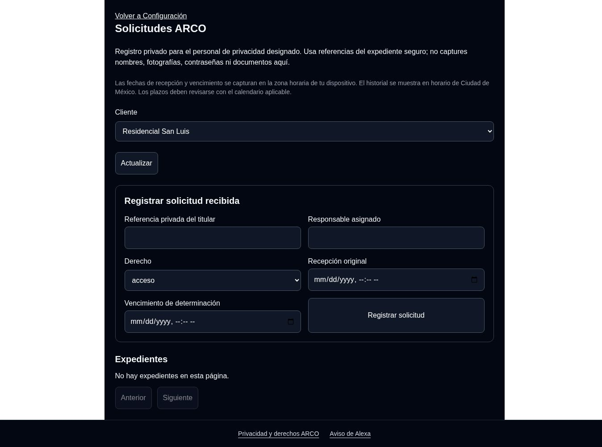

# Liberación ARCO: San Luis

Estado: desplegado y acceso productivo verificado. Fecha: 23 de octubre de 2026 UTC (22 de octubre en Ciudad de México al iniciar la liberación).

El PR #90 se fusionó en main con commit 39b2b2df3f93a721c74c25281befbe4e5656550b. Tests 39903549649 y PostgreSQL RLS 39903549590 terminaron SUCCESS sobre el head aprobado af5896cd9158536ca18b7955b53ba1b8b5994680. La suite local completa aprobó 565 pruebas, con 26 omisiones por requerir PostgreSQL desechable y 80 % de cobertura.

La conexión CORE se confirmó en Railway en modo lectura, extrayendo solo host y nombre de base: ep-rough-voice-b5vx4odv-pooler.c-7.us-east-2.aws.neon.tech/neondb. Neon confirmó proyecto patient-tree-68362559 y rama br-empty-firefly-b5ob1gsg. Tras el ensayo en la copia br-summer-queen-b536tft0, se aplicó la migración aditiva de primera aplicación. RLS habilitado y forzado; rol axs_core_app con SELECT/INSERT/UPDATE y sin DELETE. No se crearon expedientes ficticios en producción.

Backend Railway ce946879-4534-4176-81a3-11f35a8760c3: SUCCESS. Frontend Vercel dpl_5iV1ocNdWoxtqBmMCzSDAf98rHmK: READY. Ambos corresponden al commit fusionado.

La única designación productiva es usr_b8f20a70e2bb4b4e:condo_b6b00ba13ba5, Salvador / Residencial San Luis. Con sesión productiva del operador se verificó que San Luis muestra el formulario y la lista vacía. AXS Demo Condominio B mostró «Requiere designación de privacidad para este cliente», sin formulario ni expedientes. El acceso directo es https://app.axs-mx.com/dashboard/arco; seleccionar Residencial San Luis.

El enlace general de Configuración permanece oculto: la revisión automática rechazó habilitar su visibilidad para todos los usuarios por exceder el alcance limitado. No se intentó habilitarlo por otra vía. También rechazó crear una función auxiliar productiva para inspeccionar metadatos de conexión; la función no se creó y se usó la alternativa de lectura de consola.

Esta verificación productiva fue de lectura: no se registraron solicitudes, no se enviaron correos y no se borraron datos. El recorrido completo de escritura se validó previamente con expedientes ficticios en Development. El registro es asistido: registrar una referencia no verifica identidad, comunica una respuesta ni elimina datos.

Para revertir la activación: deshabilitar AXS_ARCO_CASES_ENABLED y retirar AXS_ARCO_OPERATORS, redesplegar y confirmar rechazo de acceso. Conservar esquema, expedientes y auditoría.

Este documento actualiza el estado histórico de preparación en ARCO_ACTIVACION_PRODUCCION.md. No adopta los plazos propuestos del PR #89.
